**本科毕业论文开题报告**

<table><tr><td>
毕业论文题目
</td><td>
川西藏区木构损伤的特征解耦和量化研究
</td></tr><tr><td>
选题类型
</td><td>
应用基础型
</td><td>
课题来源
</td><td>
自选课题
</td></tr><tr><td>
学  院
</td><td>
建筑与城乡规划
</td><td>
专  业
</td><td>
城乡规划
</td></tr><tr><td>
导  师
</td><td>
肖海
</td><td>
职  称
</td><td>
讲师
</td></tr><tr><td>
姓  名
</td><td>
黄尧尧
</td><td>
年  级
</td><td>
2022
</td><td>
学  号
</td><td>
202207877
</td></tr><tr><td><h2>一.立题依据</h2><h3>1.1 选题背景及意义</h3>
1.1.1 国家战略与保护理念转型 

随着我国《中华人民共和国乡村振兴促进法》的深入实施，传统村落的保护与发展已上升为国家意志 [1]。历年中央一号文件连续强调，在推进乡村全面振兴中必须处理好“传统与现代”的关系 [1]。与此同时，国家文化数字化战略明确提出，应顺应时代发展，积极运用人工智能、大数据等新技术更新遗产保护方式。在这一背景下，我国对传统建筑的保护理念正逐步从被动、事后的“抢救性修复”向主动、前置的“预防性保护”转型。

1.1.2 嘉绒藏族民居的文化与构造价值 

川西/藏区大渡河流域的嘉绒藏族民居，以其宏大的碉楼与寨房组合闻名，被誉为“嘉绒藏族文化的活化石” [1]。从构造逻辑来看，该类民居采用了独特的“石木共生”体系。尽管外观表现为厚重的片石砌筑，但其核心的受力骨架（梁、柱、斗拱、楼板、悬挑结构及门窗等）均为木质构件，主要采用当地云杉、冷杉并通过精妙的榫卯工艺连接 [1]。木构件不仅决定了建筑的整体结构安全，更是雕刻艺术与民族宗教符号的重要物质载体。

1.1.3 木质构件损伤威胁与传统检测局限 

受高原干热河谷气候、强紫外线辐射及干湿交替影响，该地区木构件普遍面临严峻的老化与损伤威胁。实地调研数据显示，该地区传统民居木质构件存在不同程度损伤的比例超过80%，其中需立即采取干预措施的严重损伤比约30%1。2019-2022 年间，该县发生 8 起局部坍塌事件，均与木质构件严重损伤未被及时发现存在直接联系 [1]。 传统的损伤检测长期依赖人工目视排查，不仅效率低下、成本高昂，且面对高耸的藏式建筑时存在极高的安全风险与视线盲区。此外，传统巡查定性为主，极易漏检隐蔽性病害，无法为城乡规划中的防灾减灾提供精准的结构化数据支撑。

1.1.4 选题意义

1.理论意义：探索“多尺度视觉特征解耦—限定约束下实现损伤由像素到物理尺寸的近似转换—空间风险特征评估”的交叉学科研究框架。为复杂纹理干扰下（彩绘/天然木纹）的细长目标检测提供兼顾精度与轻量化边缘部署的解决方案。

2.实践意义：构建“便携式移动端实时体检 + 云端 RAG 数字化监管台账”的闭环工具，解决高海拔盲区（檐下、悬挑梁等）的普查难题。将孤立的像素级病害映射为 GIS 空间风险矢量因子，为城乡规划中的防灾控制线划定与修缮资金精准分配提供宏观依据。
<h3>1.2 国内外研究文献综述</h3>
传统村落与古建筑的保护是城乡规划与建筑遗产领域的核心议题。随着国家文化数字化战略的推进，对木构建筑健康状态的监测已从传统的定性描述向基于多学科交叉的定量评估演进。针对嘉绒藏族民居这类具有复杂环境背景和独特构造的遗产对象，国内外学者在损伤病理、检测技术、智能识别及空间规划评估等方面开展了大量探索。

1.2.1 传统建筑木构件损伤的病理特征与多维形成机理研究

传统木构建筑的损伤依其物理形态、发生部位与检测可达性，通常被划分为内部隐蔽缺陷与外部表观缺陷两类。现有的病理学研究表明，木材作为一种各向异性的天然高分子有机材料（主要由纤维素、半纤维素和木质素构成），其退化机理是自然环境胁迫、生物降解与物理力学疲劳深度耦合的复杂过程。

1.气候环境主导的物理与化学降解 针对干热河谷与高原气候环境下的木材风化，国内外学者进行了长期的微观机理监测。川西高原地区（如丹巴县）具有强烈的紫外线辐射、极大的昼夜温差以及显著的干湿交替特征。现有研究指出，紫外线中的高能光子能够直接破坏木材表面的木质素大分子键，导致木质素发生光化学降解，表现为木材表面褪色、发灰及表面纤维的松散脱落（即表层腐朽与风化）。此外，木材具有显著的吸湿与解吸特性。在环境湿度剧烈波动时，木材细胞壁内的结合水含量发生变化，导致木材在弦向、径向和纵向产生不均匀的干缩湿胀。当这种由于形变不一致产生的内部拉应力超过了木材纤维间的横向结合力时，便会诱发顺纹理方向的干缩裂缝。随着服役时间的延长，温差应力与干湿循环的疲劳累积，会促使微裂纹不断向纵深扩展，最终形成贯穿性或结构性裂缝。

2.生物降解与病害的链式反应 生物侵害是导致木质构件彻底丧失承载力的最致命因素。生物学家与木材防护专家的研究表明，木腐菌（主要包括褐腐菌和白腐菌）与木材害虫（如白蚁、粉蠹）的繁衍高度依赖于局部的微气候。当隐蔽部位（如长期渗水的屋面下方、接地柱脚）的含水率长期维持在20%以上时，褐腐菌会迅速分解纤维素，导致木材体积收缩、变脆并呈现暗褐色块状开裂；白腐菌则同时分解纤维素和木质素，使木材呈海绵状变白。另一方面，害虫的侵入往往从木材表面的细微裂缝或天然木节处开始，通过啃食木材内部组织形成复杂的孔洞与通道网络。国内外大量实证调研指出，表观缺陷（如表面风化裂缝）往往是打破木材天然防护屏障的“导火索”，它为水分滞留和孢子、虫卵的侵入提供了温床，进而引发内部深层腐朽与空洞化这种不可逆的链式破坏。

1.2.2 传统结构健康监测与无损检测技术的演进与局限

在早期的建筑遗产保护实践中，针对木质构件损伤的勘察长期依赖于人工目视排查与经验判断。这种方式不仅高度依赖专家的主观经验，定性色彩浓厚，且在面对高耸险峻的藏式碉楼时，存在巨大的视线盲区与人身安全风险。为克服上述缺陷，自20世纪末以来，无损检测（NDT）与微损检测技术被广泛引入木结构健康监测领域。

1.基于应力波与超声波的内部探伤

应力波断层成像技术（Tomography）是目前国内外研究最为成熟的木材内部缺陷检测手段之一。其基本原理是通过在构件截面周边布置多个传感器，利用应力波在健康木材与腐朽/空洞区域传播速度的显著差异，通过反演算法重建截面内部的二维或三维密度分布图。大量实验室验证和现场测试表明，应力波技术能够高精度地定量识别内部空洞的面积与位置。然而，现有文献也普遍指出该技术的工程局限性：由于应力波在空气与木材界面会发生强烈的反射，该技术对表面细微裂缝和早期表层腐朽的敏感度极低；且设备昂贵、布线繁琐，单根柱子的检测往往需要数小时，极难适用于村落级别的大规模普查。

2.基于微钻阻力的微损评估

微钻阻力仪（如 Resistograph）通过记录恒定速度下细微钻针刺入木材时的机械阻力变化，来推断木材内部的密度波动与腐朽程度。国内外学者建立了大量的阻力值与木材力学性能损失的拟合曲线。尽管该方法在定点勘测中极其有效，但其本质属于“盲人摸象”式的点状检测，无法获取构件全貌。面对体量庞大的传统村落，单靠这种接触式的物理探测显然无法满足现代城乡规划对于数据全面性与时效性的要求。

1.2.3 传统计算机视觉与数字图像处理（DIP）在病害识别中的探索） 

为了实现真正意义上的大面积、非接触式自动化检测，学者们开始将目光转向计算机视觉领域。在深度学习崛起之前，基于传统数字图像处理（Digital Image Processing, DIP）的结构表面损伤识别占据了研究的主流，其核心流程被固定为“图像预处理—边缘/特征提取—形态学后处理—量化计算”。

1.边缘检测与梯度算子的应用

早期的研究大量应用了基于灰度梯度的边缘检测算子。研究者们指出，裂缝或孔洞在图像中通常表现为灰度值骤降的暗色线条或斑块。因此，Sobel 算子、Prewitt 算子以及 Canny 边缘检测器被广泛应用于路面混凝土裂缝和部分木材表面裂缝的提取中。特别是 Canny 算子，由于其引入了高斯滤波平滑降噪和双阈值边缘连接机制，在实验室理想光照下展现出了优秀的连续裂缝提取能力。

2.阈值分割与区域生长法

除了边缘检测，基于图像灰度直方图的自动阈值分割也是传统 DIP 的重要分支。Otsu 算法（最大类间方差法）被大量应用于背景与损伤区域的二值化剥离。部分学者结合区域生长算法（Region Growing），通过设定种子点及像素相似性准则，实现了对特定形状病害的连通域提取。

3.传统 DIP 在复杂乡土建筑中的失效困境

尽管传统 DIP 方法在理想环境下取得了一定成果，但近年的综述性文献一致认为，这类方法在向实际复杂工程转化时遭遇了严重的“鲁棒性危机”。传统算法高度依赖人工预设的浅层特征（如灰度差、特定形状）和硬性阈值。嘉绒藏族民居的木质构件处于极其复杂的非结构化环境中：其一是强烈的环境光影干扰，高原阳光直射产生的深邃阴影往往被梯度算子误判为粗大裂缝；其二是人工装饰与使用痕迹的干扰，藏式民居梁柱上高频分布的彩绘线条、复杂的雕刻纹样以及长期生活做饭形成的烟熏积炭，其灰度分布与真实的裂缝、腐朽高度重叠。在面对这些“伪病害”特征时，传统 DIP 方法完全不具备语义理解能力，往往导致海量的误报，彻底失去了工程预警的价值。

1.2.4 深度学习技术在建筑遗产病害识别中的突破与演进 

随着卷积神经网络（CNN）算力的飞跃，深度学习彻底颠覆了传统的特征工程范式，使建筑病害检测从“人工设计特征”走向了“数据驱动的特征自学习”。根据识别任务的精细度与目标需求，深度学习在遗产保护领域的应用经历了从图像级分类、目标级框选到像素级分割的深层演进。

1.图像级分类与病害属性判定

早期的深度学习应用多集中于病害的二分类或多分类任务。学者们利用改进的 AlexNet、VGGNet 及 ResNet 等经典 CNN 架构，将输入的局部图像块（Patch）判定为“健康”或“受损”。例如，研究证实通过引入残差结构（Residual Network），模型能够在数十甚至上百层的网络中有效避免梯度消失，从而提取到木材纹理与裂缝之间极其微弱的高维抽象特征。然而，图像级分类只能回答“有没有病害”，无法给出病害的具体位置与几何尺度，这对于需要精准定位修缮的古建筑保护而言，应用价值有限。

2. 目标检测算法：实现病害“定位”  

为解决定位问题，目标检测算法被广泛引入。褚鸿鹄基于 FPN 架构改进 Faster R-CNN，实现了对龟裂、横纵裂缝的精准分类 。为了满足实时性需求，温作林研究发现 YOLOv3 在保持 95.9% 准确率的同时检测速度远优于 VGG16 等分类网络 。张兴成基于 SSD 网络实现了混凝土裂缝的实时检测 。Song Ee Park 等尝试将 YOLO 算法与激光传感器结合，探索了视觉和物理测量的复合路径 。目前主流工程应用多采用以 YOLO 系列和 SSD 为代表的单阶段（One-stage）算法，借助一个模型直接完成定位和类别判断任务，检测效率有了极大提升 。像素级语义分割与零样本学习的兴起

3.像素级语义分割与抗干扰优化：走向精细“量化”

为了实现如裂缝宽度的精确量化，技术向像素级语义分割演进。翁飘、沈俊凯及陈波等利用改进 FCN 模型实现了路面和坝面裂缝的像素级分割 。随着 U-Net 架构的普及，朱苏雅等与任秋兵等基于该网络实现了桥梁及水工混凝土裂缝的精确分割，将裂缝宽度测量误差控制在 0.05mm 以内 。针对复杂背景干扰这一核心痛点，徐国整等与潘刚等在网络中创新性地嵌入了注意力机制，强迫模型关注损伤特征区域，显著提升了模型在干扰环境下的分割精度 。此外，代洋洋针对视网膜微血管提出的 UU-Net 模型，通过融合残差模块与注意力机制解决了细微线性目标的断连问题，这为木材细微干缩裂缝的提取提供了重要的跨学科参考 。

1.2.5古建筑木结构损伤检测的特殊性与技术瓶颈

相比于混凝土与路面工程领域成熟的智能化应用，古建筑木结构（尤其是少数民族乡土建筑）的视觉识别研究起步较晚，面临着极其特殊的应用难点与技术断层。

1.对象特异性与数据集缺失

深度学习算法的性能高度依赖于训练数据的规模与质量。目前，公开的建筑病害数据集极度缺乏针对藏式传统建筑的专用图像数据 。王念念建立的基于 CNN 的木构件裂缝与木节模型仍仅限于简单的“图像分类” 。马健率先将 YOLO v5 算法应用于古建筑木结构裂缝检测，在自建数据集上实现了 91% 的检出率 。Qiu 等人使用改进的 YOLO v8 检测屋顶缺陷，实现了在传统村落背景下的快速识别 。尽管如此，绝大部分研究未能覆盖嘉绒民居特有的彩绘装饰、烟熏积炭等复杂特征，导致模型泛化能力严重不足 。

1.复杂干扰背景下的算法适应性困境

现有通用模型未针对藏式民居复杂的结构与装饰混合特征进行优化 。在处理具有复杂背景干扰的图像时，算法难以准确剥离背景噪声 。例如，Qian 等人针对传统藏木结构提出了一种结合变分自编码器（VAE）、多头注意力机制和 LSTM 的复合深度学习模型，以处理复杂的结构响应数据，但这主要偏向于时间序列上的异常检测 。在表观视觉上，木材表面的装饰线条极易与干缩裂缝混淆，亟需引入轻量级注意力机制模块来抑制背景噪声，引导模型将计算资源聚焦于裂缝、虫眼等真实损伤特征 。

1.2.6损伤量化测算与城乡空间规划风险评估的贯通

现有的大部分计算机视觉研究仅停留在二维图像的“目标检测”阶段，缺乏适用于当地建筑材料的量化算法与分级评估标准，导致检测结果无法直接指导现场的修缮决策，存在严重的技术与应用脱节 。前沿的城乡规划交叉学科研究正致力于打通“微观视觉识别—物理尺度量化—宏观空间评估”的技术链路。

1.基于语义分割的几何物理参数量化

Hatır 等人将研究推进到古建石作领域，从单纯的“定性识别”提升到了具有工程价值的“定量评估”（如计算裂缝宽度、长度） 。Zhang 等人也提出了基于深度学习的方法，专注于中国古代木构件裂缝的识别，并进一步实现了裂缝的量化 。在实际工程应用中，通过构建基于 YOLOv8-Seg 等架构的实例分割模型，输出病害边界框与精确的二值化原型掩膜，能够精准贴合不规则裂缝与虫蛀区域的边缘 。基于掩码内的像素数量并结合空间比例尺映射关系，可自动计算裂缝的长度、平均宽度以及腐朽区域的实际物理面积，从而生成损伤密度指标，将定性的视觉图像转化为定量的工程数据 。

2.关联机制与防灾修缮的决策规划推演

更为宏观的城乡规划视角要求将单体构件的损伤数据放置于整个村落的空间与环境维度中进行审视。通过提取算法识别的损伤分布数据，可以开展空间与统计分析，揭示不同类型损伤在建筑承重结构（如主梁、大木立柱）与非承重装饰部件（如门窗、栏杆）上的分布占比规律 。更重要的是，将损伤分布空间数据与局部的自然本底因子（如迎风面/背风面、地形高程、降雨量、日照强度等微环境因素）进行地理空间关联分析，能够探究“在什么环境下最容易发生何种病害”的演化机理 。第二就是基于此空间统计与量化指标，结合《古建筑木结构维护与加固技术标准》，可建立一套空间化的防灾修缮评估体系。系统依据损伤的几何参数与构件的受力属性（引入差异化权重因子），自动生成三级干预策略：对于仅影响外观的轻微损伤（如细微干缩裂纹、零星虫眼），判定为Ⅰ级日常保养，建议非介入性监测与表面防护；对于非承重构件的中度损伤，判定为Ⅱ级一般修缮，建议剔补加固；对于关键承重构件的严重贯穿性裂缝或深度腐朽，则直接预警为Ⅲ级结构安全风险，触发抢救性干预（如碳纤维加固或落架墩接） 。这种从算法到评估规则的映射，为城乡管理者划定防灾重点控制区域、合理分配预防性保护资金提供了宏观的科学决策底座 。
<h3>1.3 本文的创新点</h3>
基于上述背景，本研究立足城乡规划专业视角，提出“微观特征解耦与宏观空间评估相贯通”的交叉学科范式，具体参考《古建筑木结构维护与加固技术标准》（GB/T 50165-2020[2]）相关技术规定：

1. 针对非结构化环境的木构建筑病害数据清洗管线： 现有研究多采用水平边界框（HBB），在面对藏式民居中倾斜细长的病害（如裂缝）时极易产生高冗余背景噪声。本研究创建了一套低成本、高精度的自动化数据清洗管线：在算力受限的条件下，跑通了“预训练模型 HBB 伪标签生成 → SAM 2.1_b 掩膜分割 → 极值收缩（MinAreaRect）”的转换链路。该方法有效剔除了复杂背景（如彩绘、烟熏、天然木纹）下大量的冗余干扰，以较低的时间与人工成本构建高质量的OBB和SEG数据集，提升模型对细长病害的特征解耦能力。

2. 物理尺度近似还原与工程预警机制：针对现有深度学习多停留在二维图像“视觉框选”、难以指导工程实践的断层，本研究引入张正友相机标定法消除镜头畸变，并在“拍摄光轴近似正射”与深度参数（Z）的先验约束下，构建透视映射模型。该机制尝试将孤立的病害像素特征，逆向解算为厘米级的物理尺寸，并直接对接《古建筑木结构维护与加固技术标准》（GB/T 50165-2020），将计算机视觉的检测黑盒转化为城乡规划管理中可量化的“三级干预（抢救性干预/一般性修缮/日常预防保养）”工程预警指标。

3.“点-线-面”递进式空间风险推演与防灾控制线划定:绝大多数结构健康监测研究缺乏向地理信息系统（GIS）转化的路径。本研究将移动端（Android）与云端协同解算的病害风险图层转化为 GIS 空间矢量因子，结合 DEM 地形与微气候等自然本底条件，进行多维环境加权叠加。通过空间核密度估计（KDE），实现了风险从单体结构失效（点）向蔓延灾害（线）、最终至连片坍塌（面）的演化推演，为传统村落防灾控制线的精准划定与预防性修缮资金的分配提供了宏观决策底座。
<h2>二.研究（规划）的主要内容</h2><h3>2.1 具体研究内容</h3>
2.1.1：研究对象选取和界定研究

本研究选取四川省甘孜州大渡河流域丹巴县的嘉绒藏族传统民居作为核心研究对象与数据集采集源。在前期跨越丹巴、康定、泸定三地共[12]个传统村落的广度普查基础上，最终聚焦丹巴县，主要基于三点科学考量：一是形制原真性，丹巴地区受异质文化冲击较小，保留了最典型的“石木共生”构造逻辑，保证了样本特征的纯度；二是病害丰富度，该地木构件占比极高（超40%），在高原干热河谷的极端气候下，老化与病害类型极为齐全，为模型构建提供了优质的数据基础；三是数据一致性，聚焦核心区域有效排除了其他地区现代风貌改造带来的特征“噪声”，使数据集分布高度集中，有助于提升深度学习模型的收敛速度与针对性泛化能力。依托上述选址逻辑，前期团队对丹巴及周边地区150余栋传统民居进行了逐栋勘察，采集了包含梁、柱、斗拱等核心构件的1000余张一手影像资料<strong>。</strong>
<table><tr><td>
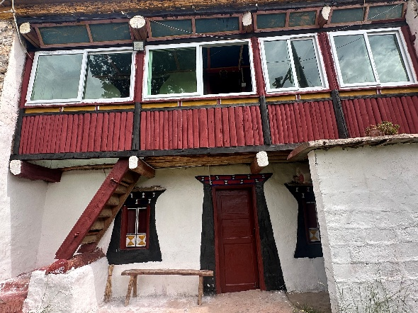
</td><td>

</td></tr><tr><td>

</td><td>
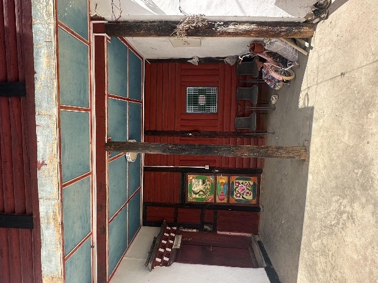
</td></tr><tr><td>
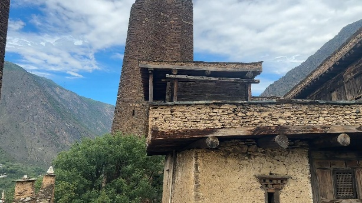
</td><td>
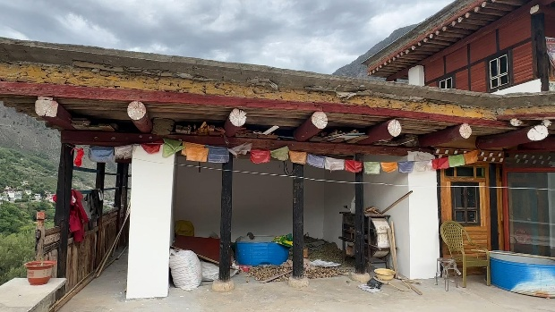
</td></tr><tr><td>
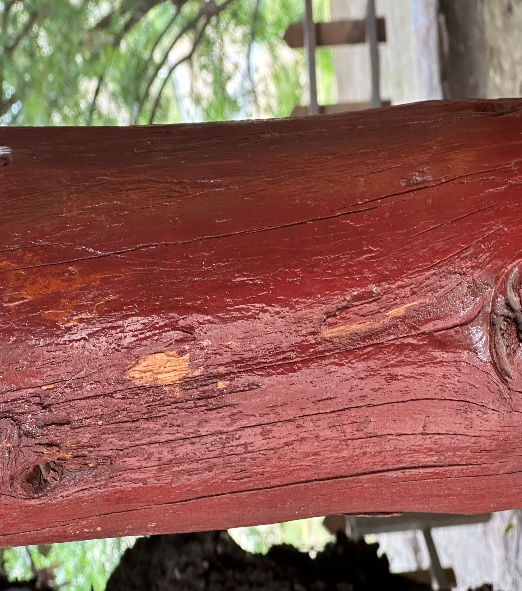
</td><td>
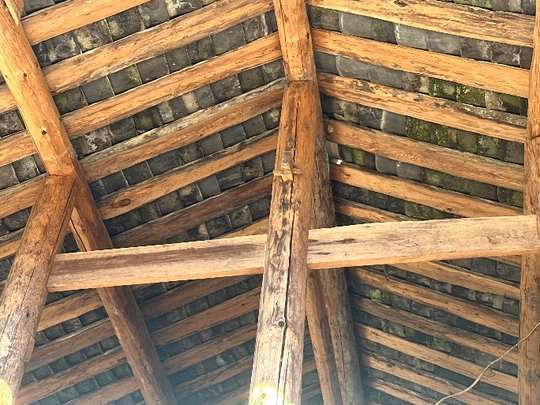
</td></tr></table>
图 1丹巴县嘉绒藏族民居

图片来源：笔者自摄

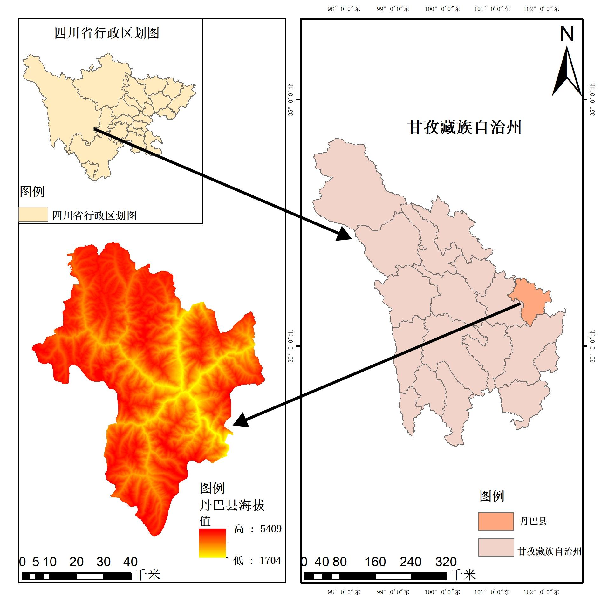图 2 研究村落区位与高程分析图

图片来源：笔者自著

2.1.2：数据集构建

1.精细化标签体系定义：木构件损伤可分为内部隐蔽缺陷与外部表观缺陷两类。前者依赖专业设备探测，后者则直观表现为裂缝、表面腐朽及虫蛀等形态。表观缺陷不仅是材质劣化的直观反映，更是内部深层病害（如空洞、深层腐烂）演化的重要先兆。基于此，实现表观缺陷的早期视觉识别与量化，是开展古建筑预防性保护的必要先决条件。因此参考《古建筑木结构维护与加固技术标准》（GB/T 50165-2020），结合前期调研，界定以下[7]类木构件损伤特征：['crack' (纵/横向裂缝), 'deep_decay' (深层腐朽), 'insect_pest' (虫蛀孔洞), 'mildew' (霉变), 'surface_decay' (表层腐朽), 'surface_defect' (机械损伤), 'wood_knot' (天然木节)]。使用开源python软件xanylabeling，数据托管平台Roboflow对其中500张图像采用水平目标框（HBB）格式完成人工标注。为后续的半监督伪标签生成提供高质量的先导样本

表 1 丹巴嘉绒藏族民居木质构件典型损伤形成机理及特征调查表
<table><tr><td>
损伤名称
</td><td>
视觉表征
</td><td>
形成机理
</td><td>
常见高发部位
</td><td>
图示
</td></tr><tr><td>
纵/横向裂缝(Crack)
</td><td>
表现为木材表面或端面的纵向、斜向及放射状裂隙。裂缝边缘常因长期氧化呈深褐色，内部可见浅黄色木质，具有高对比度的线性或不规则几何特征。
</td><td>
主要源于木材水分流失导致的干缩不均，当内部应力超过木材纹理间的结合力时引发开裂；外部荷载作用及剧烈的温差变化会加剧裂纹扩展。
</td><td>
梁、檩条、柱头、柱脚等承重构件
</td><td>
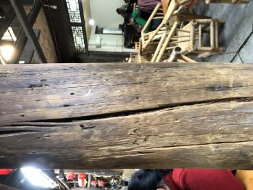
</td></tr><tr><td>
深层腐朽(Deep Decay)
</td><td>
构件表面明显凹陷、变形或呈海绵状，伴随显著的体积缺失。严重时木材呈暗褐色或灰白色块状脱落，材质疏松脆弱，与周围健康木材界限模糊。
</td><td>
长期受潮或漏水导致木腐菌（褐腐或白腐）深入侵入，大量分解纤维素和木质素，造成木材内部组织结构和力学性能的彻底破坏。
</td><td>
柱脚（接地处）、檐口、漏水屋面下方的隐蔽梁架
</td><td>
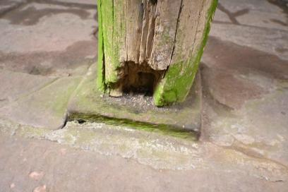
</td></tr><tr><td>
虫蛀孔洞(Insect Pest)
</td><td>
表面分布密集或零散的孔状暗斑（多为圆形或椭圆形），内部存在不规则蛀蚀通道，孔口常堆积有颜色较浅的细微木屑或粉末。
</td><td>
白蚁、粉蠹等昆虫在木材内部产卵繁殖，幼虫啃食木材纤维，形成内部空洞网络，破坏木材完整性。
</td><td>
榫卯节点、望板、背阴面及主要承重梁柱
</td><td>

</td></tr><tr><td>
霉变(Mildew)
</td><td>
木材表面出现黑色、绿色、暗红或灰白色的斑点、斑块，多呈粉末状或绒毛状附着。常呈连片分布，覆盖原有木纹。
</td><td>
局部环境通风不良且相对湿度长期偏高，导致霉菌在木材表面滋生。主要影响外观，一般不破坏力学强度，但易演变为腐朽。
</td><td>
隐蔽且通风不良的背阴面、墙体内的木柱、受潮楼板底面
</td><td>
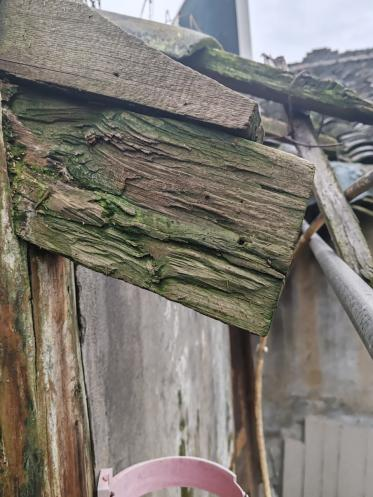
</td></tr><tr><td>
表层腐朽(Surface Decay)
</td><td>
表面木质变软、褪色（多发灰发暗），出现纵横交错的细小网状微裂纹（风化纹），纹理变得粗糙且失去光泽，用硬物刮擦易呈粉末状脱落。
</td><td>
木材表面长期暴露在强紫外线辐射及干湿交替环境中，表层木质素光降解，伴随轻微真菌侵蚀，导致表层纤维结构松散。
</td><td>
暴露在室外的悬挑梁、外露柱列、外墙木板
</td><td>
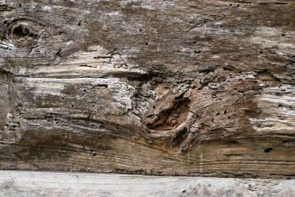
</td></tr><tr><td>
机械损伤(Surface Defect)
</td><td>
木材表面呈现明显的切削、磕碰、划痕或局部断裂。边缘通常极其不规则且锐利，常暴露出未被风化的新鲜浅色木质，与周边老旧木材色差剧烈。
</td><td>
主要由人为活动（如日常使用碰撞、后期不规范的改造修缮）或不可抗力（如落石击打、构件坠落）等外力直接物理切削、撞击导致。
</td><td>
门框、窗棂、楼梯踏步、高度较低易受人为触及的柱段
</td><td>
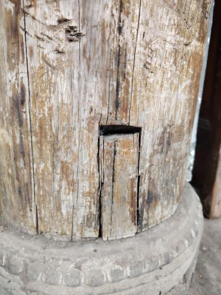
</td></tr><tr><td>
天然木节(Wood Knot)
</td><td>
表面颜色通常较周边正常木质更深，呈现圆形、椭圆形或不规则的深褐色斑块，其内部纹理呈同心圆状，且与周围正常木纹的走向极不连续。
</td><td>
树木生长过程中枝条与主干的生理性交织遗留（活节），或因病虫害、外力导致的局部组织坏死后被新生木质包裹（死节）。
</td><td>
梁、柱子、木板墙面等各类原木加工构件
</td><td>
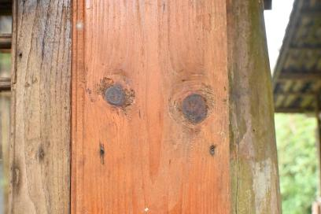
</td></tr></table>
丹
<ol><li>半监督降噪与极值收缩管线：针对手工标注 OBB 成本过高的问题，开发自动化清洗管线。首先采用小批量精标数据训练先导模型（rt-detr-r18/yolo26s迁移训练）；使用先导模型对大规模数据推理生成水平伪标签（HBB）；经过人工审核后将 HBB 作为定位 Prompt 输入本地部署的 SAM 2.1_b（利用其零样本分割能力，在消费级显卡上快速推理）；对生成的掩膜计算最小外接矩形（MinAreaRect），旋转收缩角度，实现“HBB → Mask → OBB”的降噪，剔除大量冗余背景信息。</li></ol><table><tr><td>
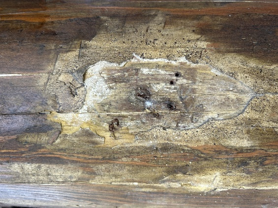原始图像
</td><td>
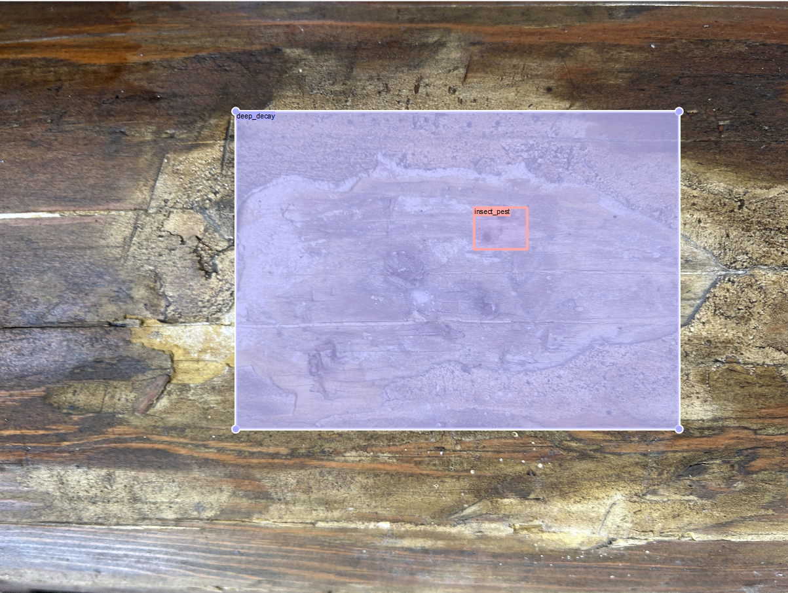水平矩形框标注
</td></tr><tr><td>
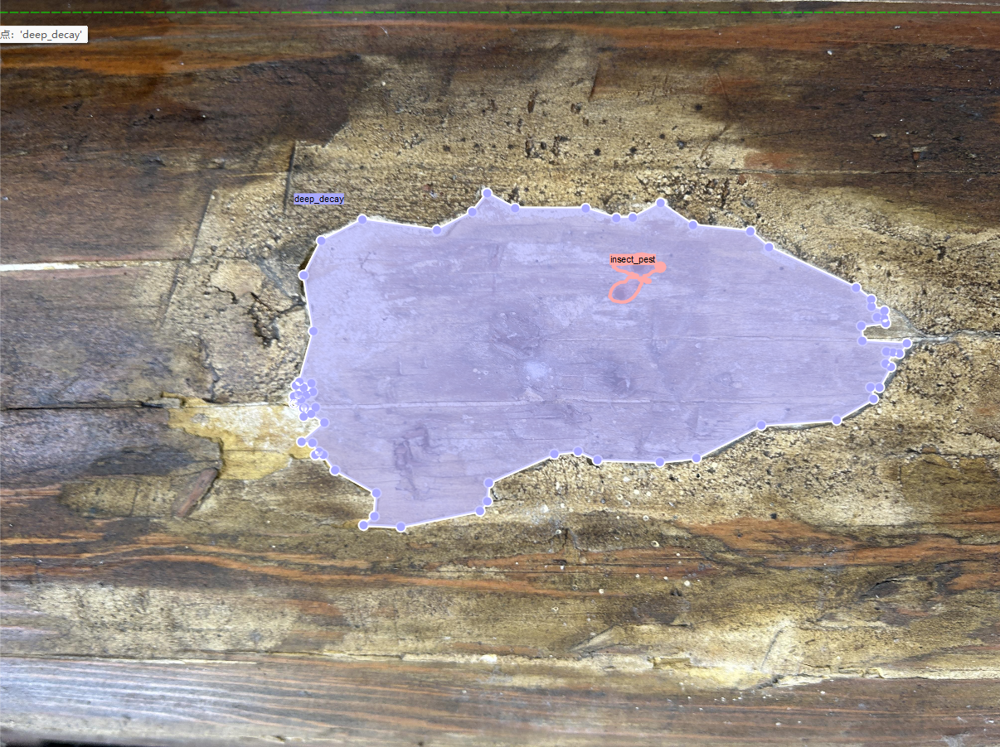SEG掩码标注
</td><td>
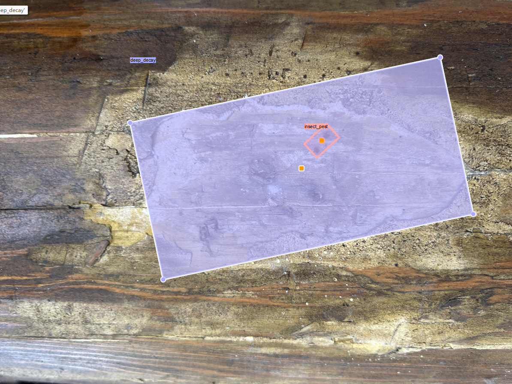旋转矩形框标注
</td></tr></table>
图3图像标注格式转换流向（从左至右）

图片来源：笔者自著

2.数据增强策略: 针对各类损伤样本极度不平衡及复杂光影干扰，基于 Albumentations 框架开发自动化增强管线。首先，依据病害频率实施动态重采样，针对性扩充稀缺病害（如深层腐朽、机械损伤），缓解长尾效应；引入 CLAHE（限制对比度自适应直方图均衡化）与随机亮暗调控来模拟强光与建筑阴影；同时叠加像素级丢弃（Pixel Dropout）、随机模糊及仿射错切（Affine Shear），提升模型在非结构化环境下的鲁棒性。
<table><tr><td>
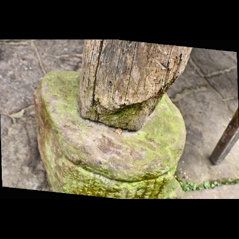
</td><td>
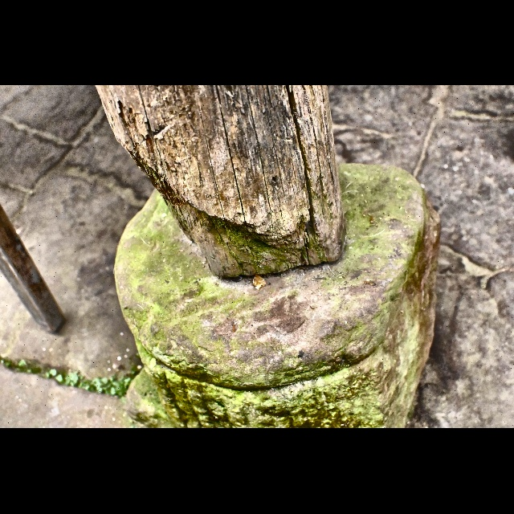
</td><td>
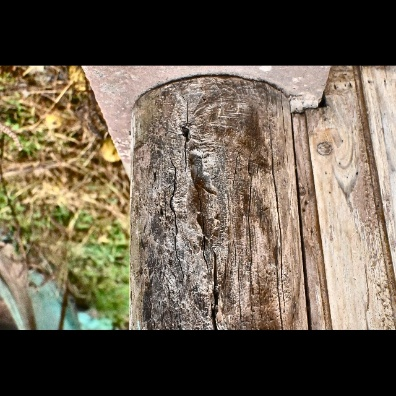
</td></tr><tr><td>
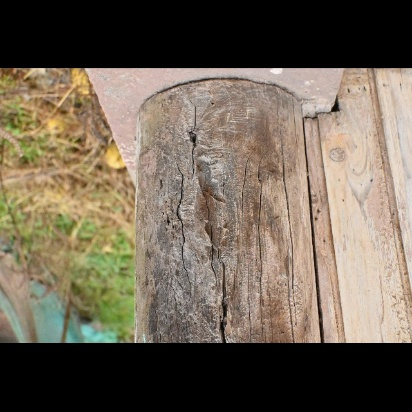
</td><td>
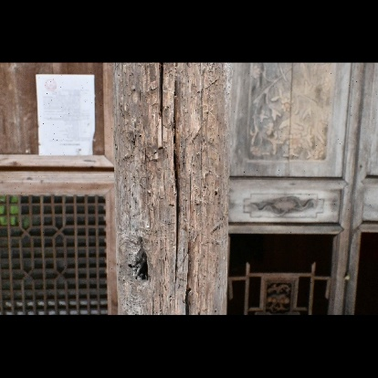
</td><td>
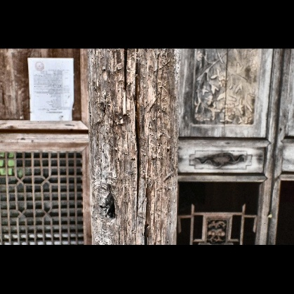
</td></tr></table>
图4图像增强样本

图片来源：笔者自著
<table><tr><td>
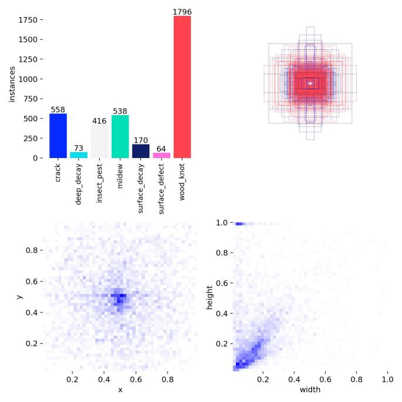
</td><td>
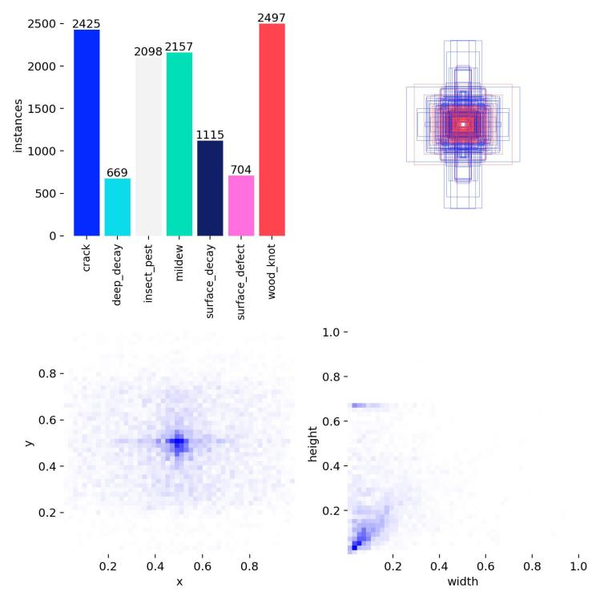
</td></tr></table>
图5增强前后的数据集结构对比，右图为增强后

图片来源：笔者自著

2.1.3：算法优化与评估

1.对于面向边缘部署的yolo，选择yolo11s作为基线，针对裂缝细长倾斜特性，引入 ProbIoU 等适配旋转框的损失函数；同时轻量化引入 EMA（高效多尺度注意力机制），以极小的算力代价抑制背景彩绘与天然木纹的视觉干扰。
<table><tr><td>
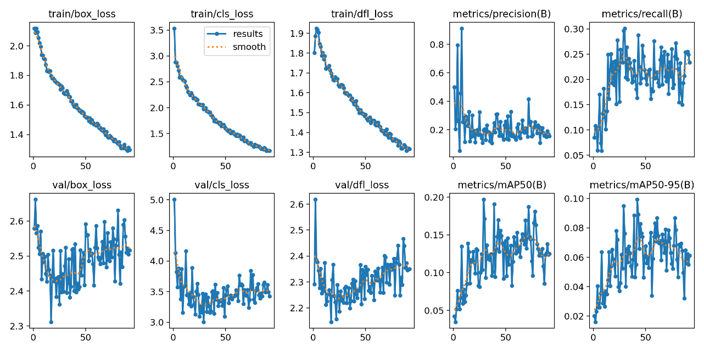
</td></tr><tr><td>
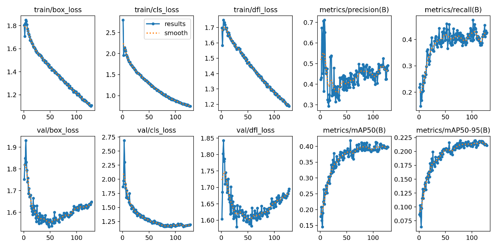
</td></tr></table>
图6基于同一训练集，算法改进前后的train_result对比，下图为改进后

图片来源：笔者自著

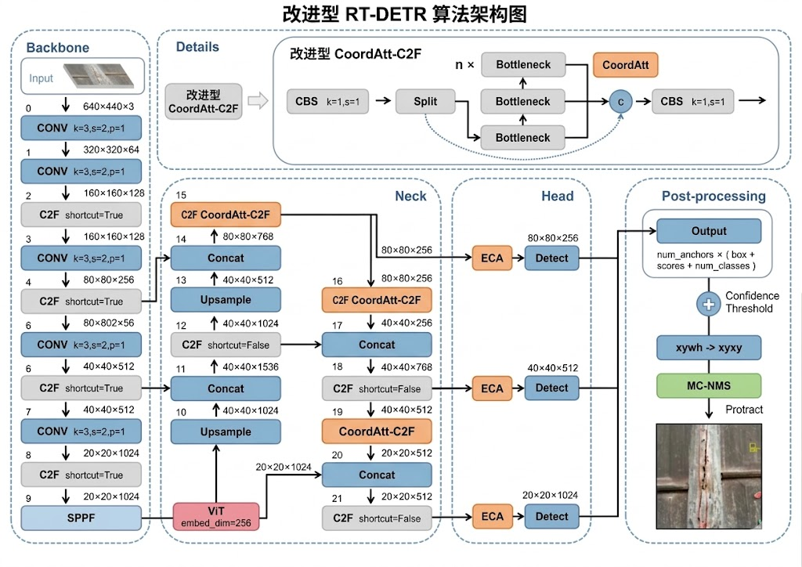2.对于云端 RAG 系统的离线高精度需求，选择 CNN 与 Transformer 混合架构的 RT-DETR-L 作为基线。针对“虫蛀孔洞、局部霉变”等微小且高度隐蔽的病害，对模型的特征交互层进行重构，强化其对全局空间上下文与局部微观纹理的捕获能力，突破复杂光影与纹理下的模型泛化能力，为规则引擎提供更高精度的视觉输入。

图7 rtdetr算法架构修改图

图片来源：笔者自著

3.构建消融实验与对比实验机制。除业界标准的平均精度均值（mAP@0.5、mAP@0.5:0.95）外，针对高频干扰下的误报与漏检问题，引入召回率（Recall）及 F1-Score（调和平均数）进行综合评定；针对长尾分布与极端尺寸差异，增设各类别独立精度（Per-class AP）与多尺度评估指标（$AP_S, AP_M, AP_L$），以严谨验证模型对不同病害特征的真实解耦能力。针对移动端算力受限的真实物理约束，在参数量（Params）与推理帧率（FPS）的基础上，增设浮点运算量（GFLOPs）与端到端推理延迟（Latency，包含前处理与 NMS 后处理耗时），全面且精准地量化轻量化改进策略（如 EMA 模块）的工程落地价值。

2.1.4：“移动端-云端”双业务场景落地研发

1.便携式移动端应用：针对川西高海拔无网/弱网的实地普查痛点，依托 NCNN 前向计算框架完成检测模型的 Android 端原生部署。在模型工程化转换阶段，基于 PNNX（PyTorch Neural Network Exchange）工具链对 YOLO 模型进行计算图优化。针对移动端复杂多变的输入分辨率需求，通过重构转换脚本，解除原生 TorchScript 计算图中的静态维度绑定（Static Shape），调整拼接操作（Concat）与注意力机制（Area Attention）的张量维度映射逻辑，实现动态尺寸推理（Dynamic Shape Inference）。此外，通过在计算图层面剥离后处理模块并交由端侧外部接管，避免了无效边界框的算力浪费，最终输出轻量的网络结构与权重文件，保障模型在算力受限设备上的流畅实时运行。通过 JNI（Java Native Interface）实现相机视频流与CPP API的高效跨语言交互。为保障实时检测帧率（FPS），引入 Vulkan API 开启移动端 GPU 硬件加速，实现脱离云端算力依赖的高效病害检测闭环。
<table><tr><td>

</td><td>
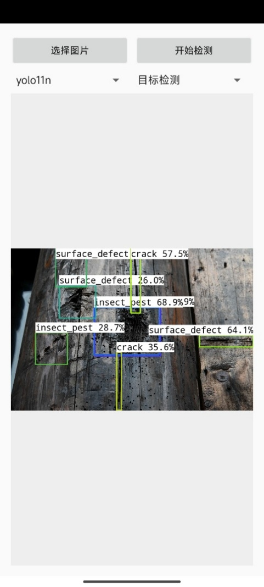
</td></tr></table>
图8安卓应用展示图

图片来源：笔者自著

2.云端 RAG 智慧监管原型：构建基于检索增强生成（RAG）的自动化体检报告生成引擎mvp(最小可行产品)。首先构建包含《古建筑木结构维护与加固技术标准》、地方修缮指导意见及历史案例的本地向量知识库；视觉解算数据经由规则引擎评定初步等级后，利用 llama.cpp 在本地化部署的小参数大模型（如 Qwen3.5 27B 8-bit 量化版）中进行精准检索与归纳，生成包含“病害快照—规范依据—修缮建议”的综合性电子档案。

2.1.5：损伤结构物理大小量化测算

1.相对尺度近似解算：在“拍摄光轴近似正射”的假定下，基于张正友相机标定法获取设备内参并消除透镜畸变；同步结合实地勘察中激光测距获取的深度约束先验（Z），构建“像素坐标 → 图像物理坐标 → 世界坐标”的透视映射模型，逆向解算出木构件病害的厘米级物理尺寸。

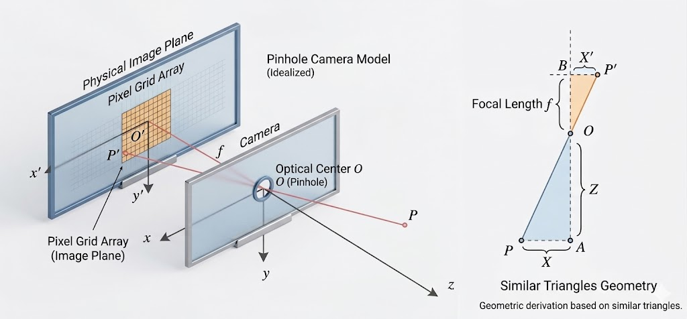

图9 针孔相机原理示意图

图片来源：网络查询

2.三级干预规则引擎：依据现行国家标准中关于木构件损伤容许值的量化规定，构建白盒计算逻辑。将上述解算的相对物理尺寸直接映射为城乡规划管理所需的风险严重程度（划分为：抢救性干预、一般性修缮、日常预防保养三级），为后续防灾规划提供具备工程依据的数据底座。

2.1.6：基于 GIS 的空间风险特征评估

1.GIS 映射与落位：提取移动端采集影像的 EXIF 经纬度信息，将视觉识别的病害类别、严重程度及物理尺寸参数，转化为矢量点要素落位至 ArcGIS Pro 平台，构建结构化的传统村落构件级健康属性数据库。

2.多维环境因子叠加分析：提取 ALOS DEM 数据的坡度、坡向、高程特征，并整合干热河谷微气候（如日照时数、温湿度变化率）等矢量环境图层，利用 ArcGIS Spatial Analyst 进行多因子空间加权叠加分析，计算各区域的“综合环境暴露指数”。

3.空间集聚风险画像与灾害链路推演： 运用空间核密度估计（KDE）识别病害高频集聚的“热点街巷”。结合村落空间肌理，推演从单体结构失效的“点风险”、到火灾/倾覆蔓延的“线风险”、最终至连片坍塌的“面风险”演化路径。
<h3>2.2 拟解决的关键问题</h3>
1.复杂干扰下细长目标特征解耦与 OBB 精度提升；如何通过引入 EMA 注意力与 ProbIoU 损失函数，实现抗干扰的精准感知。

2.脱离像素束缚的物理尺度近似转换机制：如何在近似正射与深度约束的特定局限性下，建立合理的透视映射模型，实现像素向“厘米级相对尺度”工程预警指标的转换。

3.视觉感知向城乡规划空间决策的链路映射：如何将边缘侧零散的视觉检测结果，通过工程分级规则与 GIS 空间统计整合，转化为宏观尺度的防灾控制线划定与修缮资金精准分配规划方案。
<h2>三.预期目标</h2>
本课题预期在毕业答辩前达成以下具体目标：

1.毕业论文文本：严格遵守《2026版建筑与城乡规划学院开题及毕业设计撰写总体规范》，撰写并提交总字数不少于 10,000 字的高质量学术论文（研究调研报告类），逻辑严密，图表规范。

2.数据集与算法模型资产：构建并保存一份具有[7]类精细化 OBB /SEG标签的嘉绒藏族木构件损伤数据集,训练完成的YOLOv11/RT-DETR 权重文件。

3.软硬件交互原型展示：提交一套可在 Android 设备运行的便携式检测应用录屏演示文件，以及云端基于 RAG 技术自动生成的“木构件体检报告”样例（PDF 文档），附上相关的代码仓库github链接及其release应用程序。

4.城乡规划专项图纸与空间策略：依托 ArcGIS 输出包含《病害空间分布核密度热力图》、《多因子叠加综合暴露风险图》在内的系列规划图纸；形成一套结构化的修缮资金分配建议矩阵表。

5.汇报与答辩文件：制作逻辑清晰、图文并茂的毕业答辩 PPT 汇报文件，全面涵盖背景、方法、实验结果与规划策略推演。
<h2>四.研究（规划）方法与步骤</h2>
<strong>4.1 研究方案</strong>

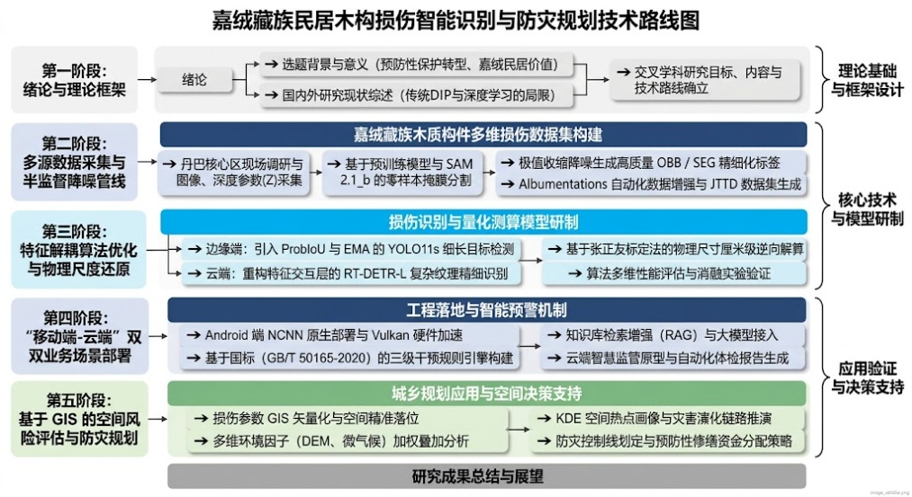结合前文对嘉绒藏族传统民居木质构件损伤机理的剖析及现有检测手段的痛点，本研究确立了“微观特征解耦—物理尺度近似还原—宏观空间评估”的核心研究逻辑。整个研究过程按照数据底座构建、核心算法研发与优化、移动端/云端工程应用转化、以及城乡规划空间策略推演四个层级逐次递进，最终形成闭环的木构件损伤智能识别与防灾预警体系。具体的各项任务逻辑关联与执行先后顺序如技术路线图10所示。

图10 技术路线图

图片来源：笔者自著

<strong>4.2 研究方法</strong>

本课题立足城乡规划专业视角，引入计算机视觉、深度学习与地理信息系统（GIS）技术[16]解决传统村落保护中的实际工程痛点，具有显著的多学科交叉融合特征。为确保研究的科学性、严谨性与落地应用价值，拟采用以下五种主要研究方法：

1.文献研究与规范梳理法 为确保对研究问题的精准界定，本研究通过广泛查阅国内外关于古建筑木结构健康监测、目标检测算法（YOLO、DETR系列）及传统村落防灾规划的文献，梳理现有方法的局限性。同时，深入研读《古建筑木结构维护与加固技术标准》（GB/T 50165-2020）等国家规范，为构建 7 类损伤标签体系及三级工程干预规则引擎提供坚实的理论与工程规范基础。

2.实地勘测与实证分析法 为使深度学习模型具备真实的场景泛化能力，本研究选取四川省甘孜州大渡河流域丹巴县的典型嘉绒藏族民居作为实证对象。深入村落一线，采用高清数码单反相机采集复杂光影与高频彩绘干扰下的木质构件原生图像；同步利用激光测距仪记录拍摄深度先验数据（Z），为后续透视映射模型的构建提供物理参数。基于真实采集的非结构化环境数据，完成自动化标注管线的跑通与算法验证。

3.跨学科交叉研究法 结合城乡规划学与计算机科学，构建兼顾边缘端轻量化与云端高精度的双架构检测流程： 首先，为解决细长病害（如裂缝）的标注冗余难题，采用预训练模型结合 SAM 2.1_b 零样本分割技术，通过极值收缩算法实现 HBB 到 OBB 及 SEG 掩膜的高效降噪转换。其次，在移动端引入改进型 YOLO11s，融合 ProbIoU 与 EMA（高效多尺度注意力机制）实现复杂背景下的特征解耦；在云端 RAG 系统中部署重构特征交互层的 RT-DETR-L 模型，强化微小隐蔽病害的感知。最终，结合张正友相机标定法与深度先验，建立“像素—物理尺度”透视映射模型，实现构件损伤厘米级量化测算的自动化输出。

4.GIS 空间分析方法 突破传统计算机视觉仅停留在二维图像框选的局限，本研究引入地理信息系统空间分析法。将视觉解算输出的病害风险特征转化为矢量要素落位至 ArcGIS Pro 平台。通过提取 ALOS DEM 地形及微气候数据，运用空间多因子加权叠加与核密度估计（KDE），识别高频集聚风险热点。以此推演灾害从单体结构失效到连片坍塌的演化链路，为划定防灾控制线和分配修缮资金提供宏观空间决策依据。

5.对比实验与消融分析法 为严谨论证本研究算法改进的有效性与工程落地价值，设计多维度的对比与消融实验。横向对比实验将本课题改进的 YOLO11s/RT-DETR 模型与主流基线算法进行严格对照；在评估指标上，除常规的 mAP 外，针对极端尺寸差异与干扰误报，增设 Recall（召回率）、F1-Score 及多尺度评估指标（AP_S, AP_M, AP_L）。消融实验则通过逐步增删模块（如 EMA 注意力、旋转框损失函数），定量分析各项改进对模型精度的实际贡献。同时，结合算力受限物理背景，引入参数量（Params）、浮点运算量（GFLOPs）与端到端推理延迟（Latency）等轻量化工程指标进行综合评判。 
<h2>五.论文（规划）进度安排</h2>
本研究进度及其安排见表 2所示

表2 论文进度安排
<table><tr><td>
计划时间
</td><td>
完成内容及深度
</td></tr><tr><td>
第 9 学期第 1 周-第 4 周
</td><td>
政策文献检索与开题报告撰写及答辩
</td></tr><tr><td>
第 9 学期第 3 周-第 6 周
</td><td>
丹巴核心区现场调研与多源数据采集
</td></tr><tr><td>
第 9 学期第 5 周-第 16 周
</td><td>
YOLO11s/RT-DETR算法优化与消融实验
</td></tr><tr><td>
第 9 学期第 10 周-第 15 周
</td><td>
Android移动端原生部署与RAG原型测试
</td></tr><tr><td>
第 9 学期第 15 周-第 10 学期第 4 周
</td><td>
物理尺度逆向解算与三级干预规则库构建
</td></tr><tr><td>
第 9 学期第 15 周-第 10 学期第 6 周
</td><td>
GIS多维环境叠加分析与防灾控制线划定
</td></tr><tr><td>
第 10 学期第 5 周-第 16 周
</td><td>
GIS图纸汇总、数据梳理与毕业论文撰写
</td></tr><tr><td>
第 10 学期第 12 周-第 16 周
</td><td>
答辩汇报演示文件(PPT)制作与正式答辩
</td></tr><tr><td></td><td></td></tr><tr><td></td></tr></table><h2>六.参考文献</h2>
[1] 全国人民代表大会常务委员会. 中华人民共和国乡村振兴促进法[Z]. 2021.

[2] 住房和城乡建设部. 古建筑木结构维护与加固技术标准: GB/T 50165-2020[S]. 北京: 中国建筑出版传媒有限公司, 2020.

[3] 胡冬雯, 张菁. 家屋的拓扑学: 嘉绒藏族民居建筑的有机更新[J]. 建筑学报, 2025(04): 113-118.

[4] 张大玉, 刘洋, 等. 中国传统村落空间分布特征及影响因素研究[J]. 中国园林, 2025, 41(09): 61-68.

[5] 钟明全. 疲劳加载对部分预应力混凝土梁钢筋应力、裂缝宽度及静力强度的影响[J]. 西南交通大学学报, 1995(03): 283-290.

[6] 聂建国, 沈聚敏. 钢筋混凝土梁长期斜裂缝宽度的试验研究[J]. 建筑结构学报, 1995(03): 1-9.

[7] 马健, 阎卫东, 刘国奇, 等. 基于YOLO v5的古建筑木结构裂缝检测方法[J]. 沈阳建筑大学学报(自然科学版), 2021, 37(05):

  927-934.

[8] 杨娜, 张翀, 李天昊. 基于无人机与计算机视觉的中国古建筑木结构裂缝监测系统设计[J]. 工程力学, 2021, 38(03): 27-39.

[9] QIU H, ZHANG J, ZHUO L, et al. Research on intelligent monitoring technology for roof damage of traditional

  Chinese residential buildings based on improved YOLOv8[J]. Heritage Science, 2024, 12(1): 231.

[10] TANG H, FENG Y, et al. Application of Object Detection Algorithm for Efficient Damages Identification of the

  Conservation of Heritage Buildings[J]. Archaeological Prospection, 2024, 31(3): 233-247.

[11] CHAURASIA S, et al. YOLO-CSL: A Lightweight Rotated Detector for Oriented Object Detection[J]. IEEE Access, 2023.

[12] CHEN Y, WU W, LI J. Adaptive Attention-Enhanced Yolo for Wall Crack Detection[J]. Applied Sciences-Basel, 2024,

 14(17): 7821.

[13] ZHU X, ZHU Q, ZHANG Q, et al. Deep learning-based 3D reconstruction of ancient buildings with surface damage

  identification and localization[J]. Structures, 2025, 73: 108253.

[14] HALLEE M J, NAPOLITANO R K, REINHART W F, et al. Crack Detection in Images of Masonry Using CNNs[J]. Sensors,

  2021, 21(14): 4702.

[15] SOGE A O, POPOOLA O I, ADETOYINBO A A. Detection of wood decay and cavities in living trees: a review[J].

  Canadian Journal of Forest Research, 2021, 51(7): 937-947.

[16] DAI M, HUANG X, XU Y, et al. Spatial patterns and influencing factors of traditional villages in the Pearl

  River–Xijiang River Economic Belt[J]. PLoS ONE, 2025, 20(4): e0321646.
</td></tr><tr><td colspan="2"></td></tr><tr><td colspan="2">
导师意见

                                    导师签名： 

 

                          年    月    日 
</td></tr></table>

注：1. 选题类型：基础型、应用基础型、应用型、调研型；

2. 课题来源：国家重点研发计划项目，国家社科规划、基金项目，国家自然科学基金项目，中央、国家各部门项目，教育部人文、社会科学研究项目，省（自治区、直辖市）项目，国际合作研究项目，与港、澳、台合作研究项目，企、事业单位委托项目，外资项目，国防项目，学校自选项目，非立项，其他。